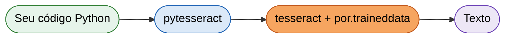

# Instalação e configuração

Guia passo a passo para rodar a API de verificação de assinatura do zero, no
Linux (Ubuntu/Debian). Para saber o que o endpoint faz e o que ele responde,
veja o [README.md](README.md).

## Visão geral

O projeto precisa de três coisas rodando na máquina:

| Peça | Para que serve |
|------|----------------|
| **Python 3.13 + uv** | Roda a API (FastAPI + Uvicorn). |
| **Tesseract OCR** (com português) | Lê o documento e acha a palavra-âncora ("Diretora"). |
| **Ollama** + `qwen2.5vl:3b` | Modelo de visão que decide se o recorte tem assinatura. |

### Tesseract × pytesseract: um é o motor, o outro é a ponte



| | **tesseract** (motor) | **pytesseract** (biblioteca Python) |
|---|---|---|
| O que é | Programa em C++ que **faz o OCR** de verdade. | **Wrapper**: não faz OCR sozinho. Chama o executável `tesseract` e lê a resposta. |
| Como instala | Pelo sistema operacional (`apt`, passo 1). | Com pip/uv, junto das dependências (passo 4). |
| Como usa | Sozinho pelo terminal: `tesseract placa.png saida -l por` | No código: `pytesseract.image_to_string(img, lang="por")` |

Por isso os dois passos são necessários: sem o `tesseract` do sistema, o
`pytesseract` dá `TesseractNotFoundError`, e sem o `por.traineddata`
(pacote `tesseract-ocr-por`), o idioma português não existe. Docs e código:
[github.com/madmaze/pytesseract](https://github.com/madmaze/pytesseract).

## 1. Pacotes do sistema

```bash
sudo apt update
sudo apt install -y tesseract-ocr tesseract-ocr-por
```

Confira se o idioma português foi instalado:

```bash
tesseract --list-langs   # precisa aparecer "por"
```

> O `opencv-python` costuma funcionar sem nada extra. Se aparecer um erro com
> `libGL.so.1`, instale `sudo apt install -y libgl1`.

## 2. Python e uv

O projeto usa Python 3.13 (definido em `.python-version`) e o gerenciador
[uv](https://docs.astral.sh/uv/).

```bash
curl -LsSf https://astral.sh/uv/install.sh | sh
```

Não é preciso instalar o Python 3.13 manualmente. O `uv` baixa a versão certa
na primeira execução.

## 3. Ollama e o modelo

Instale o Ollama:

```bash
curl -fsSL https://ollama.com/install.sh | sh
```

Baixe o modelo de visão (cerca de 3 GB):

```bash
ollama pull qwen2.5vl:3b
```

Confira se o serviço está no ar:

```bash
curl http://localhost:11434/api/tags   # deve listar qwen2.5vl:3b
```

Se não estiver, rode `ollama serve` em outro terminal.

> **GPU:** o `qwen2.5vl:3b` roda bem em uma GPU com 6 GB. Modelos maiores, como
> o `qwen2.5vl:7b`, precisam de mais memória de vídeo e ficam lentos ou caem
> para a CPU.

## 4. Dependências do projeto

Na pasta `apps/`:

```bash
uv sync
```

Esse comando cria o `.venv` e instala o que está no `pyproject.toml`/`uv.lock`
(FastAPI, Uvicorn, pytesseract, OpenCV, ollama, Pydantic, python-multipart etc.).

## 5. Rodar a API

Sempre a partir da pasta `apps/`, porque os imports começam em `src.`:

```bash
uv run uvicorn src.api.app:app --reload
```

| Endereço | O que tem |
|----------|-----------|
| <http://localhost:8000/> | Página web para enviar a imagem. |
| <http://localhost:8000/docs> | Documentação interativa (Swagger). |
| `POST /signature-detections` | O endpoint em si. |

Para testar pelo terminal:

```bash
curl -X POST http://localhost:8000/signature-detections -F "image=@certificado.png"
```

> O `--reload` só observa a pasta de onde o Uvicorn foi iniciado. Se você
> iniciar de outra pasta, as mudanças no código não recarregam.

## 6. Configuração

Toda a configuração fica em `src/api/config.py`. Não há arquivo `.env`.

| Constante | Padrão | Para que serve |
|-----------|--------|----------------|
| `OLLAMA_HOST` | `http://localhost:11434` | Endereço do Ollama. |
| `MODEL` | `qwen2.5vl:3b` | Modelo de visão usado no Ollama. |
| `OCR_LANG` | `por` | Idioma do Tesseract. |
| `OCR_CONFIG` | `--psm 6` | Modo de leitura do Tesseract (bloco de texto). |
| `ANCORA` | `Diretora` | Palavra impressa logo abaixo da assinatura. |
| `TIPOS_PERMITIDOS` | PNG, JPEG, WEBP | Tipos aceitos no upload. |
| `TAMANHO_MAXIMO` | 10 MB | Tamanho máximo do arquivo (o `main.js` usa o mesmo limite). |
| `LOG_FILE` | `logs/signature.log` | Log de cada requisição. |
| `CROPS_DIR` | `logs/recortes/` | Cada recorte enviado ao modelo, salvo em PNG. |

Outros ajustes:

- **Endereço do Ollama:** a constante `OLLAMA_HOST` em `config.py` (padrão
  `http://localhost:11434`). Para usar um Ollama em outra máquina, altere ali.
- **Opções do modelo:** `DEFAULT_OPTIONS` no mesmo arquivo. `temperature: 0` e
  `seed: 42` deixam a resposta o mais estável possível.
- **Prompt:** `SYSTEM_PROMPT` e `USER_PROMPT`, também em `ollama_service.py`.
- **Recorte da rubrica:** parâmetros de `crop_signature` em
  `src/services/tesseract_service.py` (`up`, `pad`, `ink_threshold`).

## 7. Logs e recortes

A pasta `logs/` é criada sozinha na primeira requisição e está no `.gitignore`.

```bash
tail -f logs/signature.log      # acompanhar as requisições
ls logs/recortes/               # ver exatamente o que o modelo recebeu
```

Cada linha do log começa com o nome do arquivo enviado, por exemplo
`[certificado.png] Resultado: tem_assinatura=true`.

> Os recortes são de documentos reais. Apague `logs/recortes/` de vez em quando
> e não compartilhe essa pasta.

## 8. Expor na internet com ngrok (opcional)

```bash
uv run uvicorn src.api.app:app --host 127.0.0.1 --port 8000
ngrok http 8000 --basic-auth "usuario:senha-forte"
```

Use sempre `--basic-auth`. Sem ele, qualquer pessoa com o link envia imagens e
usa sua GPU. Não use `--reload` enquanto o link estiver aberto.

## Problemas comuns

| Sintoma | Causa provável | Solução |
|---------|----------------|---------|
| `502 Erro no Ollama` | Ollama parado ou modelo não baixado. | `ollama serve` e `ollama pull qwen2.5vl:3b`. |
| `422 Região da assinatura não encontrada.` | O OCR não achou "Diretora". | Use uma imagem mais nítida, reta e com maior resolução, ou ajuste `ANCORA`. |
| `TesseractNotFoundError` | Tesseract não instalado. | `sudo apt install tesseract-ocr`. |
| Erro com `por.traineddata` | Falta o idioma português. | `sudo apt install tesseract-ocr-por`. |
| `ModuleNotFoundError: src` | Uvicorn iniciado fora de `apps/`. | `cd apps` antes de rodar. |
| A página mostra resultado antigo | Cache do navegador. | Ctrl+Shift+R, ou aumente o `?v=` no `index.html`. |
| Primeira requisição lenta | O modelo está sendo carregado na GPU. | Normal. Ele fica carregado por 10 min (`keep_alive`). |
